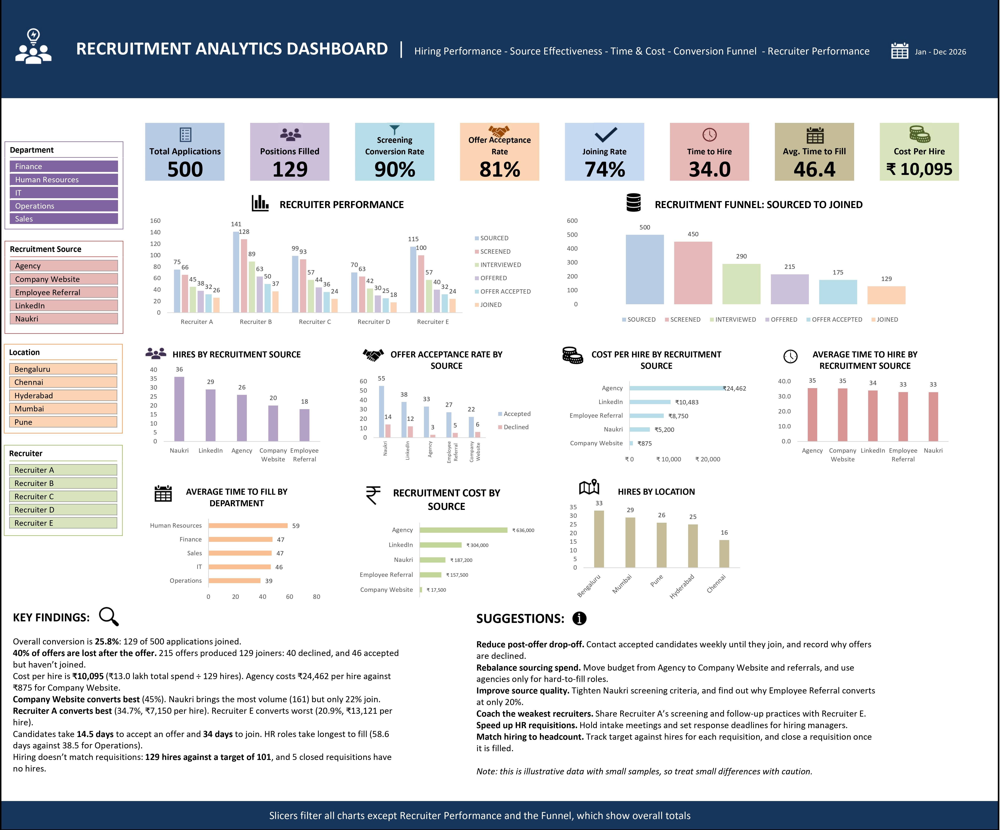

# Recruitment Analytics Dashboard (Excel)

An interactive Excel dashboard analysing the hiring funnel, recruiter and source performance, cost and time metrics for 500 candidates across 60 requisitions.

**Live case study:** https://meghagowda812.github.io/recruitment-analytics-dashboard

## Business questions
- Where are candidates dropping out of the funnel?
- Which recruiters and sources convert best, and at what cost?
- How long do hiring and requisition fill take?

## Key findings
- Overall conversion is 25.8% (129 of 500 applications joined).
- 40% of offers are lost after the offer: 40 declined and 46 accepted but have not joined.
- Cost per hire is ₹10,095. Agency costs ₹24,462 per hire against ₹875 for Company Website.
- Company Website converts best (45%). Naukri brings the most volume but only 22% join.
- Recruiter A converts best (34.7%). Recruiter E converts worst (20.9%).
- Time to hire is 34 days (application to joining). Average time to fill is 46.4 days.
- 129 hires were made against a target headcount of 101.

## Recommendations
Reduce post-offer drop-off with pre-boarding follow-ups, rebalance sourcing spend towards Company Website and referrals, coach lower-converting recruiters, and track hires against headcount per requisition.

## Approach
1. Structured the candidate and requisition data as Excel Tables.
2. Added calculated columns (time to join, joined flag, time to fill) with lookup formulas.
3. Built pivot tables and pivot charts for the funnel, recruiter performance, source, location and department.
4. Added slicers, KPI tiles, and a findings and suggestions section.
5. Audited the metrics against the raw data. Cost per hire is total spend divided by hires, not the average cost of hired candidates only.

## Tools
Excel (PivotTables, PivotCharts, slicers, XLOOKUP/VLOOKUP, COUNTIFS/SUMIFS, structured references, calculated fields)

## Files
- `Recruitment_Analytics_Dashboard.xlsx`: workbook with data, calculations, pivots and dashboard
- `images/dashboard.jpg`: dashboard screenshot
- `index.html`: case-study page published with GitHub Pages

## Note
The data is illustrative, with small samples, so differences of a few percentage points should be read with caution.
